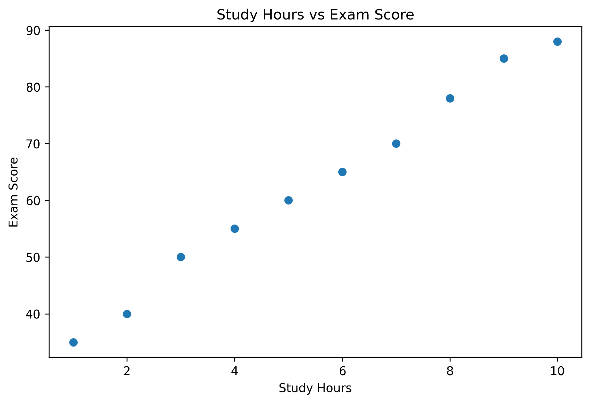
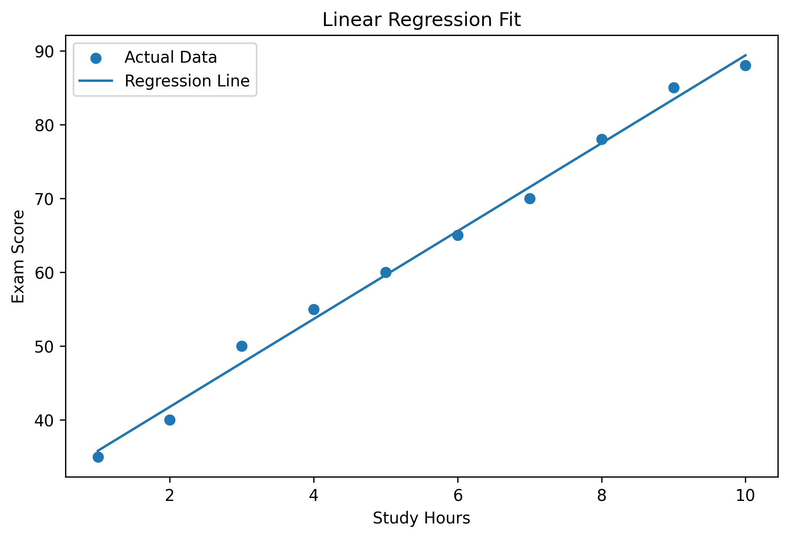
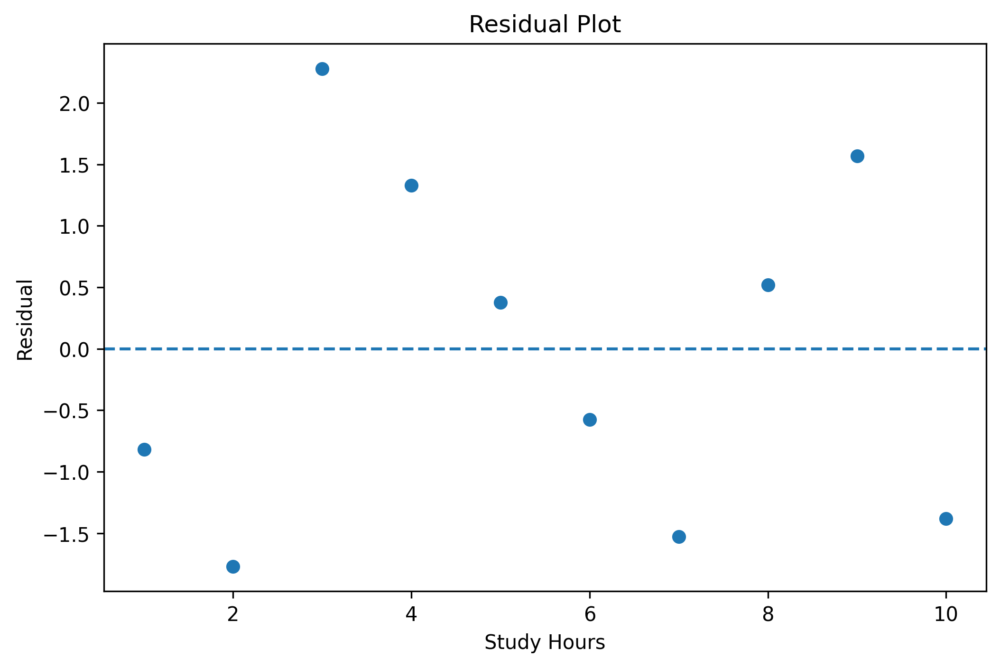

# Linear Regression: Model Behavior and Explainability

## Goal

This project explores how a simple Linear Regression model makes predictions and how its behavior can be interpreted.

The aim is not only to train a model, but also to understand:

- what the coefficient means,
- what the intercept means,
- how prediction errors behave,
- how residuals help us evaluate the model,
- where the model may fail.

## Dataset

In this first project, I use a simple synthetic dataset.

The dataset represents the relationship between study hours and exam scores.

## Model

The model used in this project is Linear Regression.

Linear Regression tries to find the best-fitting straight line between the input variable and the target variable.

## Explainability Focus

Linear Regression is one of the most interpretable machine learning models because its coefficient directly shows how the input feature affects the prediction.

In this project, I focus on:

- coefficient interpretation,
- intercept interpretation,
- prediction errors,
- residual analysis,
- R² score,
- model limitations.

## Files

- `notebook.ipynb`: Python implementation
- `report.md`: model behavior analysis
- `model-card.md`: model description and limitations
- `error-analysis.md`: analysis of prediction errors
- `figures/`: saved plots

## Visual Outputs

### Study Hours vs Exam Score

### Linear Regression Fit

### Residual Plot

